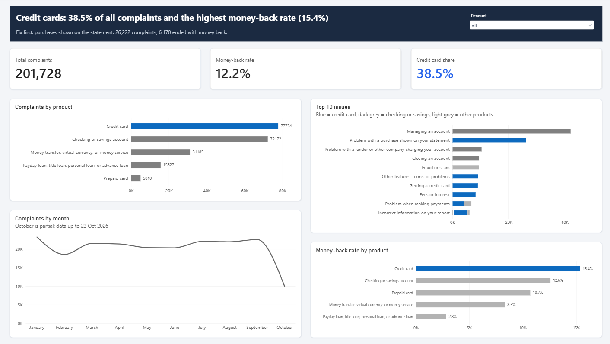

# US Bank & Fintech Complaints (CFPB, 2026)

🎥 [Video walkthrough](https://youtu.be/Dj91yN9ftkc)

## Context
**Who asks:** the Customer Experience team at a US fintech.
**Question:** Which financial products get the most complaints, and which issues cause them?
**Decision:** what to fix first to bring complaints down.

## Summary
**Credit cards.** They have 38.5% of all complaints and the highest money-back rate (15.4%).
Fix first: **purchases shown on the statement**. 26,222 complaints, and 6,170 of them ended with money back to the customer.

## Data source
- Source: [CFPB Consumer Complaint Database](https://www.consumerfinance.gov/data-research/consumer-complaints/) (public, US government).
- 201,728 complaints from 1 Jan to 23 Oct 2026, for 5 products: credit card, checking or savings account, money transfer, payday/personal loan, prepaid card.
- The CFPB export allows 100,000 rows per download, so I downloaded 3 files by product and joined them in SQL.

## Approach
1. **BigQuery (SQL):** uploaded the 3 CSV files as tables, checked the row count of each one, and joined them with `UNION ALL` into one table (201,728 rows).
2. **SQL analysis:** complaints by product, top issues, product + issue pairs, and how often complaints ended with money back. Queries are in the [`SQL`](SQL) folder.
3. **Power BI:** connected to BigQuery, cleaned the data in Power Query (date column, empty values), and built a one-page dashboard with a product filter.

## Main findings
**Complaint volume**
1. Two products make up 74% of all complaints: credit card (77,734) and checking or savings account (72,172).
2. Complaints are concentrated. There are 64 different issues, but the top 2 are 34% of all complaints: "Managing an account" (42,090, all checking or savings) and "Problem with a purchase shown on your statement" (26,222, all credit card).
3. Only 4 product + issue pairs explain 44% of all complaints. Fixing a few problems would move the total a lot.

**Customer refunds**
4. 12.2% of all complaints ended with money back to the customer (24,592). 85% of those were credit card or checking.
5. Credit cards have the highest money-back rate of all products (15.4%). Payday and personal loans have the lowest (2.8%).
6. "Purchase shown on your statement" returns the most money of any issue: 6,170 complaints with money back.
7. Credit card "fees or interest" complaints end with money back 27.8% of the time, about 1 in 4. That suggests many of these complaints are valid.

## Recommended actions
1. **Start with credit card statement purchases.** It's the biggest credit card issue and the one that returns the most money.
2. **Review credit card fees and interest.** It has the highest money-back rate, so the problem is likely real, not a misunderstanding.
3. **For checking accounts, look at "managing an account".** It's the biggest issue overall (42,090).

## Data limitations
- October is partial (data up to 23 Oct 2026), so the drop in the monthly chart is not real.
- The data shows how many complaints ended with money back, not how much money.
- Credit reporting complaints were excluded. They are about the credit bureaus, not fintech products, and they are about 90% of the database.
- The newest complaints may still be "in progress", so the money-back numbers can still go up.

## Repository contents
- `dashboard.png`: dashboard image
- `cfpb-complaints.pbix`: Power BI file
- `SQL/`: my BigQuery queries

## Contact
**Catalina Gonzalez**
- LinkedIn: [linkedin.com/in/catalinagonzalezgarciadelahuerta](https://www.linkedin.com/in/catalinagonzalezgarciadelahuerta)
- Email: catagonzalez760@gmail.com
